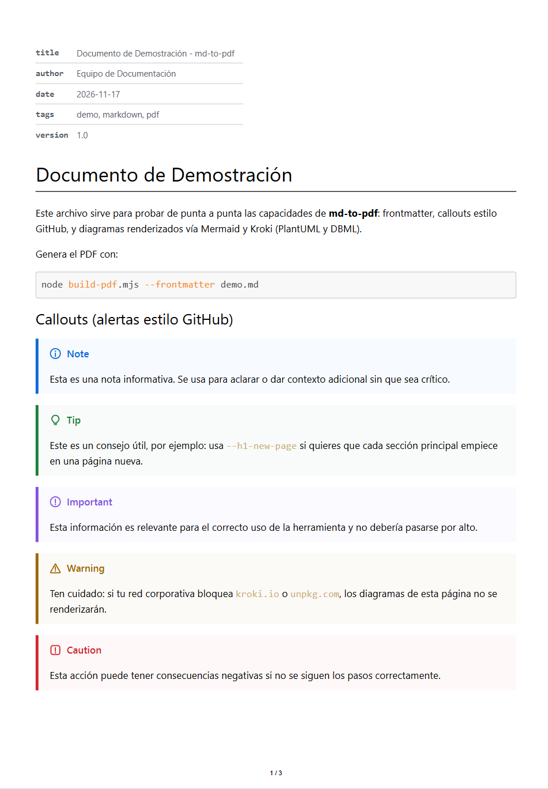
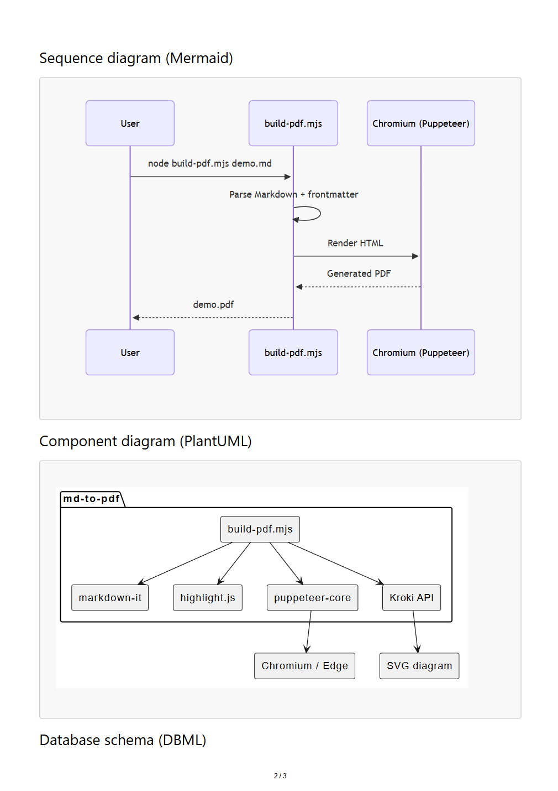
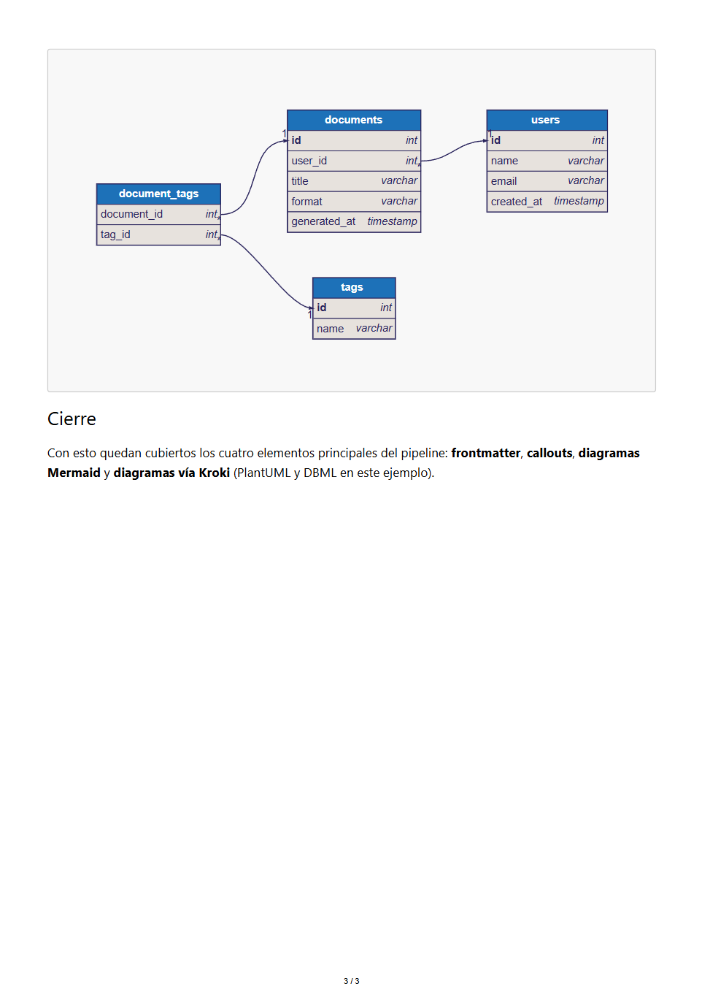
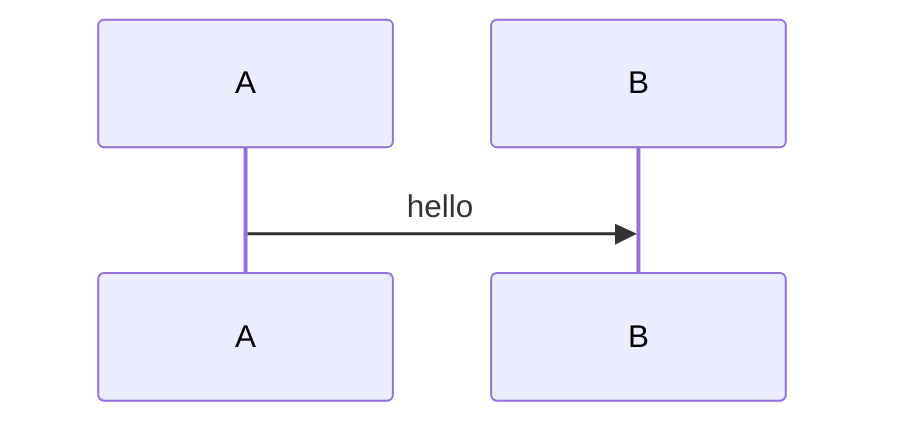
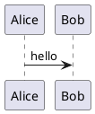

# md-to-pdf

Converts Markdown to PDF with a clean, self-contained pipeline (markdown-it parser + highlight.js + Chromium printing engine). No pandoc.

## Features

- Clean rendering: consistent typography, tables, blockquotes, and syntax highlighting
- **Mermaid**: diagrams rendered as real graphics
- **~35 diagram types via Kroki**: `plantuml`, `dbml`, `dot`/graphviz, `bpmn`, `c4`, `d2`, `act`, `erb`, `excalidraw`, `flowchart`, `nomnoml`, `sql`, `vega`, etc. (see `KROKI_TYPES` in `build-pdf.mjs`)
- **GitHub style alerts**: `> [!NOTE]`, `[!TIP]`, `[!IMPORTANT]`, `[!WARNING]`, `[!CAUTION]` with colors and icons
- **YAML frontmatter**: hidden by default; optionally shown as a discreet table
- **Page breaks**: manual (`<!-- page-break -->`) and automatic per H1/H2
- Accepts individual files and folders (with or without recursion)

## Example

[example/demo.md](example/demo.md) exercises the full pipeline in a single document: YAML
frontmatter, the five GitHub-style callouts, a Mermaid sequence diagram, a PlantUML component
diagram, and a DBML schema. Generate it with:

```powershell
node build-pdf.mjs --frontmatter example\demo.md
```

Preview of the resulting PDF ([example/demo.pdf](example/demo.pdf)):





## Requirements

- Node.js 22.12+ (required by `puppeteer-core` 25.x)
- Microsoft Edge or Chrome installed (auto-detected; used as the headless printing engine)
- Internet during generation for: mermaid (unpkg CDN) and Kroki diagrams (kroki.io)

## Installation

```powershell
cd md-to-pdf
npm install
```

## Usage

```powershell
node build-pdf.mjs <file.md | folder> [...] [flags]
```

| Argument / Flag | Description |
|---|---|
| `<file.md>` | File to convert (relative or absolute paths) |
| `<folder>` | Converts all `.md` files in the folder (can be mixed with files) |
| `--frontmatter` | Shows the frontmatter as a discreet table at the top (hidden by default) |
| `--h1-new-page` | Each H1 starts on a new page |
| `--h2-new-page` | Each H2 starts on a new page |
| `--recursive` | When given a folder, includes subfolders |
| `--out <folder>` | Saves the PDFs to that folder (created if it doesn't exist). By default each PDF is written next to its `.md` |

### Examples

```powershell
node build-pdf.mjs doc.md                          # doc.pdf next to the .md
node build-pdf.mjs docs\                           # all .md files in docs\
node build-pdf.mjs --recursive docs\               # includes subfolders
node build-pdf.mjs --out pdf\ docs\ notes.md       # folder + file → pdf\
node build-pdf.mjs --frontmatter --h2-new-page doc.md

# Using the npm script instead of calling node directly
npm run pdf -- --frontmatter example\demo.md

# Installed globally (via `npm link`) as the `mdtopdf` command
npm link
mdtopdf --frontmatter example\demo.md
```

## Diagrams

Code blocks whose language is listed in `KROKI_TYPES` are converted to SVG images from kroki.io:

````markdown




```dbml
Table users { id int [pk] }
```
````

To add a new type: one line in the `KROKI_TYPES` map in `build-pdf.mjs` (`language: "kroki-type"` per https://kroki.io). Languages not listed render as regular highlighted code.

## Alerts

GitHub-style callouts, written as a blockquote whose first line is one of the five supported tags:

```markdown
> [!NOTE]
> Useful information that users should know, even when skimming content.

> [!TIP]
> Helpful advice for doing things better or more easily.

> [!IMPORTANT]
> Key information users need to know to achieve their goal.

> [!WARNING]
> Urgent info that needs immediate user attention to avoid problems.

> [!CAUTION]
> Advises about risks or negative outcomes of certain actions.
```

Each type gets its own color and icon (see the preview in [Example](#example)). You can also give a
callout a custom title instead of the default one, e.g. `> [!NOTE] Heads up`.

## Page breaks

Manual — write it on its own line where you want the break:

```markdown
Previous text...

<!-- page-break -->

## Section starting on a new page
```

Automatic — with the `--h1-new-page` / `--h2-new-page` flags. If a heading is already at the top of a page, no blank page is generated.

## Notes

- The document title comes from the `title` field of the frontmatter (if present); otherwise the file name is used.
- Footer: page number "X / Y". Header: none.
- In corporate environments, if your proxy blocks kroki.io or unpkg.com, diagrams will not load (the rest of the document is still generated).

## Structure

```
md-to-pdf/
├── build-pdf.mjs      # main script
├── package.json
├── LICENSE
├── styles/            # CSS (markdown.css, markdown-pdf.css, code-highlighting-tomorrow.css)
├── template/          # HTML template
└── example/           # sample demo.md + PDF preview screenshots
```

The tool is fully self-contained: it ships its own styles and template.

## Powered by

- [markdown-it](https://github.com/markdown-it/markdown-it) — Markdown parsing
- [markdown-it-emoji](https://github.com/markdown-it/markdown-it-emoji) — `:emoji:` shortcodes
- [highlight.js](https://github.com/highlightjs/highlight.js) — syntax highlighting (Tomorrow theme)
- [Puppeteer](https://pptr.dev/) (`puppeteer-core`) — drives Chromium/Edge headlessly to print the PDF
- [Mermaid](https://mermaid.js.org/) — diagrams rendered client-side via CDN
- [Kroki](https://kroki.io/) — renders PlantUML, DBML, Graphviz, and ~30 other diagram languages as SVG

## License

[BSD 3-Clause](LICENSE)
