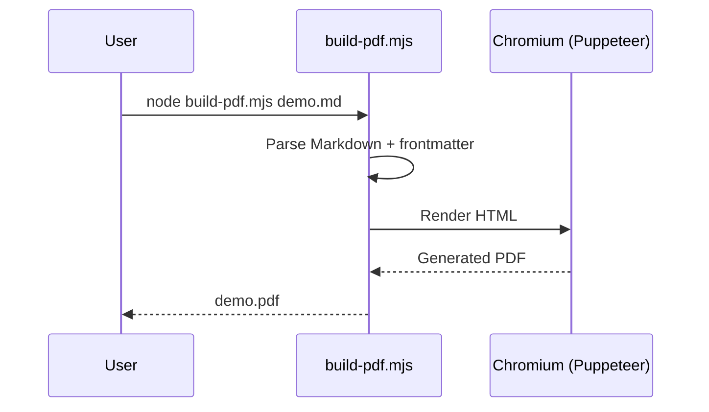
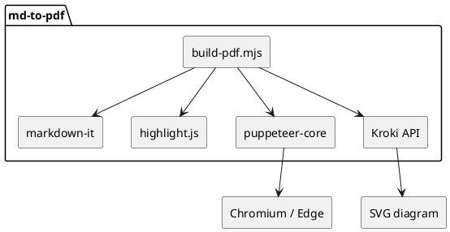

# Demo Document

This file exercises the full pipeline of **md-to-pdf** end to end: frontmatter,
GitHub-style callouts, and diagrams rendered via Mermaid and Kroki (PlantUML and DBML).

Generate the PDF with:

```powershell
node build-pdf.mjs --frontmatter example\demo.md
```

## Callouts (GitHub-style alerts)

> [!NOTE]
> This is an informational note. Use it to clarify or add extra context without being critical.

> [!TIP]
> This is a helpful tip, for example: use `--h1-new-page` if you want every top-level section to
> start on a new page.

> [!IMPORTANT]
> This information is relevant for correct use of the tool and shouldn't be overlooked.

> [!WARNING]
> Be careful: if your corporate network blocks `kroki.io` or `unpkg.com`, the diagrams on this
> page won't render.

> [!CAUTION]
> This action can have negative consequences if the steps aren't followed correctly.

<!-- page-break -->

## Sequence diagram (Mermaid)



## Component diagram (PlantUML)



## Database schema (DBML)

```dbml
Table users {
  id int [pk, increment]
  name varchar
  email varchar [unique]
  created_at timestamp
}

Table documents {
  id int [pk, increment]
  user_id int [ref: > users.id]
  title varchar
  format varchar [note: 'pdf, html, etc.']
  generated_at timestamp
}

Table tags {
  id int [pk, increment]
  name varchar [unique]
}

Table document_tags {
  document_id int [ref: > documents.id]
  tag_id int [ref: > tags.id]
}
```

## Wrap-up

This covers the four main elements of the pipeline: **frontmatter**, **callouts**,
**Mermaid diagrams**, and **diagrams via Kroki** (PlantUML and DBML in this example).
