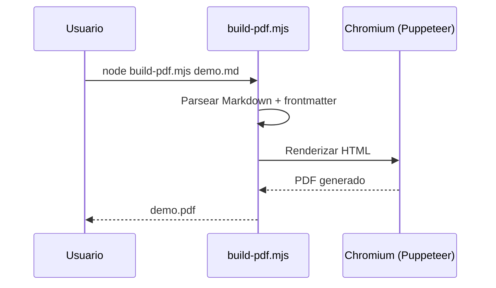
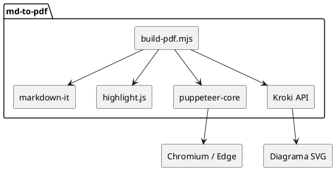

# Documento de Demostración

Este archivo sirve para probar de punta a punta las capacidades de **md-to-pdf**: frontmatter,
callouts estilo GitHub, y diagramas renderizados vía Mermaid y Kroki (PlantUML y DBML).

Genera el PDF con:

```powershell
node build-pdf.mjs --frontmatter example\demo.md
```

## Callouts (alertas estilo GitHub)

> [!NOTE]
> Esta es una nota informativa. Se usa para aclarar o dar contexto adicional sin que sea crítico.

> [!TIP]
> Este es un consejo útil, por ejemplo: usa `--h1-new-page` si quieres que cada sección principal
> empiece en una página nueva.

> [!IMPORTANT]
> Esta información es relevante para el correcto uso de la herramienta y no debería pasarse por alto.

> [!WARNING]
> Ten cuidado: si tu red corporativa bloquea `kroki.io` o `unpkg.com`, los diagramas de esta
> página no se renderizarán.

> [!CAUTION]
> Esta acción puede tener consecuencias negativas si no se siguen los pasos correctamente.

<!-- page-break -->

## Diagrama de secuencia (Mermaid)



## Diagrama de componentes (PlantUML)



## Esquema de base de datos (DBML)

```dbml
Table users {
  id int [pk, increment]
  name varchar
  email varchar [unique]
  created_at timestamp
}

Table documents {
  id int [pk, increment]
  user_id int [ref: > users.id]
  title varchar
  format varchar [note: 'pdf, html, etc.']
  generated_at timestamp
}

Table tags {
  id int [pk, increment]
  name varchar [unique]
}

Table document_tags {
  document_id int [ref: > documents.id]
  tag_id int [ref: > tags.id]
}
```

## Cierre

Con esto quedan cubiertos los cuatro elementos principales del pipeline: **frontmatter**,
**callouts**, **diagramas Mermaid** y **diagramas vía Kroki** (PlantUML y DBML en este ejemplo).
